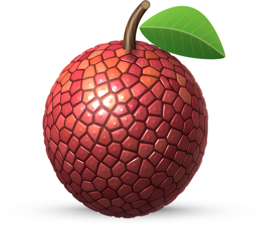
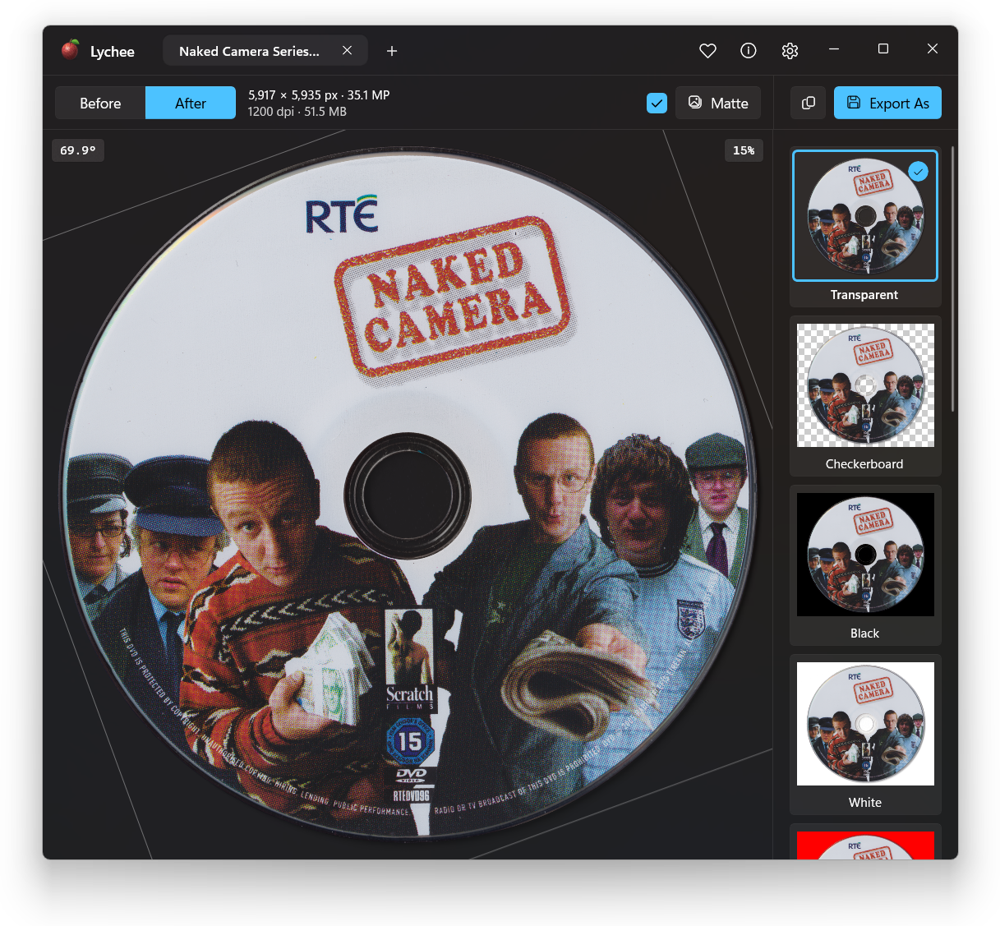

<h1 align="center"> Lychee</h1>

<p align="center">
  <a href="https://github.com/Homemediadb/Lychee/blob/main/LICENSE">
    
  </a>
  
  <a href="https://github.com/microsoft/microsoft-ui-xaml">
    
  </a>
  <a href="https://github.com/Homemediadb/Lychee/actions/workflows/ci.yml">
    
  </a>
</p>



Removes the white scanner background from scans of CDs, DVDs and Blu-rays: the background becomes
transparent, the disc's shadow is kept as soft translucent shading, and the result is trimmed and centered on
the disc. One `Lychee.exe` is both a Windows app and a command line.

## Scanning

Scan raw and lossless (PNG or BMP), with no level, color, sharpening or dust correction: Lychee reads the white
point and lighting from the background. Leave a margin of background all round the disc, corners included.

Scans can be PNG, JPEG, WebP or BMP and may hold several discs; each disc gets its own PNG, in reading order,
at the scan's dpi.

## Matting

On its own, a scan over white gives an opaque disc with a transparent hole. To make the clear plastic
see-through too, scan the same disc again over black without moving it or changing the settings, and use
**Matte**: the difference between the two scans gives each pixel its real opacity and color. The two scans must
line up pixel for pixel.

## Algorithm

1. **Levels**: the corners set the white point, and a lighting surface is fitted to the background.
2. **Outer edge**: discs are found, and rays from each center find where background, shadow and disc meet,
   fitted with a robust ellipse.
3. **Hole**: the innermost ring seen most of the way round (without matting).
4. **Alpha**: the disc keeps its pixels with feathered edges; the background becomes transparent and the
   shadow translucent shading. With matting the whole disc is matted from the pair.
5. **Trim**: cropped square and centered on the disc, shadow included.
6. **Auto Rotation**: Windows' OCR reads the print at several angles, spell-checked words vote, and a clear
   winner levels the disc; otherwise it's left as scanned. Needs an OCR language installed in Windows.

## App

Open scans with **+**, the welcome screen, drag and drop, or from Explorer; each gets a tab, and a disc's scans
over white and black opened together share one with Matte on.

- **Before / After** (B) compares the scan and the result; the wheel zooms, dragging pans, double-click toggles
  fit and 100%.
- Right-drag turns the disc; click the angle to reset it.
- The backdrops beside the stage are only for viewing; the saved PNG is transparent.
- **Batch Mode** processes a list of scans into an output folder, pairing scans over white and black for
  matting automatically.
- Settings (theme, Auto Rotation, file name suffix) are saved to `%LocalAppData%\Lychee\settings.json`.

| Keys | Action |
|---|---|
| B | Before / After |
| Ctrl+S | Export As |
| Ctrl+Shift+C | Copy the result |
| Ctrl+O | Open scans |
| Ctrl+W | Close tab |
| Ctrl+Tab / Ctrl+Shift+Tab, Ctrl+1–9 | Switch tabs |
| F1 | Open Lychee on GitHub |

## Command line

```
Lychee IMAGE [IMAGE ...] [-b BLACK [BLACK ...]] [-o OUTDIR]
              [--no-auto-rotation] [--ocr-language TAG] [--max-rotation DEG]
```

Saves `IMAGE_nobg.png` (or `IMAGE_disc1_nobg.png`, ... for several discs) next to each scan or in `OUTDIR`.
`-b` gives one scan over black per image, in order, for matting. Exit code 0 when all succeeded, 1 when any
failed, 2 for bad arguments. `Lychee --help` lists the options. The command line ignores the app's settings.

From a terminal, `Lychee.exe` with arguments runs as the command line. Started any other way, or without
arguments, it opens the app with those scans.

## Development

Needs the .NET 10 SDK on Windows.

```
pwsh -File check.ps1                              # build, format, checks, lint
pwsh -File build.ps1 [-Version 1.2.3] [-NoInstaller]  # release build in dist\, installer in installer\Output\
```

Pushing a `v1.2.3` tag publishes a release with the installer and a portable zip.

## Licensing

Lychee is distributed under the **GNU General Public License v3.0** (see [LICENSE](LICENSE)).

The release bundles the .NET runtime (MIT) and the Windows App SDK (Microsoft Software License Terms); the
details are in [THIRD-PARTY-NOTICES.md](THIRD-PARTY-NOTICES.md), with the license texts in
[`licenses/`](licenses/). Both ship alongside the binaries.

---

© rlaphoenix 2026
